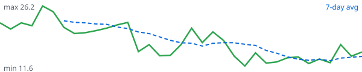

# daily-data-tracker

A small data pipeline that runs every day and builds its own dataset over time:

- **Weather in Breda** (max/min temperature, rain, sunshine) from [Open-Meteo](https://open-meteo.com/) (CC BY 4.0)
- **EUR exchange rates** (USD, GBP, CHF, TRY) from the ECB via [Frankfurter](https://www.frankfurter.app/)

Pure Python standard library for the pipeline; `pytest` for tests.

```bash
python -m tracker.run fetch            # store yesterday's data (safe to re-run)
python -m tracker.run fetch 2026-09-01 # backfill a specific day
python -m tracker.run report           # rebuild the stats below + chart
python -m pytest
```

## Max temperature, last 60 days

Solid green: daily max · dashed blue: trailing 7-day average (appears once 7 days are stored).



## Stats

<!-- stats:start -->
**Days tracked:** 33 weather · 23 FX

- Average max temperature: **17.6 °C**
- Warmest day: **26.2 °C** · Coldest max: **11.6 °C**
- Last 7 days vs. the 7 before (avg max): **13.5 °C** vs. 15.4 °C (-1.9 °C)
- Total rain: **112.0 mm** · Dry days: **11**
- Coldest night: **4.8 °C** on 2026-10-12
- First frost (min below 0 °C): none yet
- Warmest night: **17.8 °C** on 2026-09-30
- Largest day/night range: **13.4 °C** on 2026-09-25
- Sunniest day: **11.1 h** on 2026-09-25 · Average sunshine: **7.8 h/day**
- Wettest day: **28.7 mm** on 2026-10-23
- Wettest day's share of all rain: **26%** (28.7 mm on 2026-10-23)
- Share of rain from the 3 wettest days: **54%** (2026-10-23 28.7 mm, 2026-10-24 20.4 mm, 2026-10-25 11.0 mm)
- Rain intensity (wet days only): **5.1 mm/day** over 22 wet days
- Rainiest week: **68.3 mm** (2026-10-20 → 2026-10-26)
- Longest dry streak: **5 days** (2026-10-02 → 2026-10-06)
- Longest wet run: **12 days** (2026-10-16 → 2026-10-27), 82.9 mm at 6.9 mm/day
- Wettest run by total rain: **82.9 mm** over 12 days (2026-10-16 → 2026-10-27)
- Wet spells of 3+ days: 3; latest **6.9 mm/day** over 12 days (2026-10-16 → 2026-10-27) vs. 4.6 mm/day over 5 days (2026-10-07 → 2026-10-11), heavier
- Dry spells of 3+ days: 2 (lengths 3, 5); latest **5 days** (2026-10-02 → 2026-10-06) vs. 3 days (2026-09-25 → 2026-09-27), longer
- Sunshine during dry spells (avg h/day): 2026-09-25 → 2026-09-27 9.9 h · 2026-10-02 → 2026-10-06 10.2 h
- Current run: **12 wet days in a row** since 2026-10-16
- Longest warm streak (max > 20 °C): **7 days** (2026-09-25 → 2026-10-01)
- Wettest weekday so far: **Friday** (8.1 mm on average over 5 days)
- Sunniest weekday so far: **Sunday** (9.9 h on average over 5 days)
- Mildest nights by weekday: **Wednesday** (11.9 °C average min over 4 days)
- Coldest days by weekday: **Saturday** (16.1 °C average max over 5 days)
- Widest day/night range by weekday: **Monday** (8.6 °C average max − min over 5 days)
- Day/night range by week: 10.0 → 9.9 → 7.7 → 6.8 → 4.6 °C; latest week (2026-10-21 → 2026-10-27) **4.6 °C** vs. 10.0 °C in the first, narrowing
- Dry days by weekday: Mon 2/5 · Tue 1/5 · Wed 1/4 · Thu 1/4 · Fri 2/5 · Sat 2/5 · Sun 2/5
- Weekend vs. weekday rain: **4.5 mm/day** over 10 weekend days vs. 2.9 mm/day over 23 weekdays
- Weekend vs. weekday sunshine: **9.3 h/day** over 10 weekend days vs. 7.2 h/day over 23 weekdays
- Weekend vs. weekday max temperature: **16.2 °C** over 10 weekend days vs. 18.3 °C over 23 weekdays (-2.1 °C)
- Weekend vs. weekday night (min) temperature: **9.1 °C** over 10 weekend days vs. 10.4 °C over 23 weekdays (-1.3 °C)
- Rain vs. sunshine correlation: **r = -0.28**

Last 7 days (Breda):

| Date | Max °C | Min °C | Rain mm | Sun h |
|---|---|---|---|---|
| 2026-10-27 | 16.8 | 9.6 | 1.8 | 2.37 |
| 2026-10-26 | 12.4 | 7.7 | 0.7 | 3.76 |
| 2026-10-25 | 13.3 | 10.4 | 11.0 | 9.18 |
| 2026-10-24 | 12.2 | 8.9 | 20.4 | 6.48 |
| 2026-10-23 | 13.8 | 9.6 | 28.7 | 5.0 |
| 2026-10-22 | 13.6 | 7.8 | 4.2 | 8.1 |
| 2026-10-21 | 12.6 | 8.8 | 0.9 | 2.59 |

Latest EUR rates (2026-10-27): USD 1.115 · GBP 0.83658 · CHF 0.9239 · TRY 55.513

Change vs. 2026-10-26: USD -0.34% · GBP -0.19% · CHF -0.04% · TRY -0.29%

Change since tracking started (2026-09-25): USD -2.22% · GBP -2.77% · CHF -2.18% · TRY -0.51%

Biggest single-day move since tracking started: CHF -1.67% on 2026-10-02

Best and worst 5-business-day move:

- USD: best **+0.42%** (2026-10-09 → 2026-10-16) · worst **-1.57%** (2026-09-30 → 2026-10-07)
- GBP: best **-0.10%** (2026-10-08 → 2026-10-15) · worst **-1.24%** (2026-09-28 → 2026-10-05)
- CHF: best **+0.37%** (2026-10-02 → 2026-10-09) · worst **-1.78%** (2026-09-30 → 2026-10-07)
- TRY: best **+1.14%** (2026-10-09 → 2026-10-16) · worst **-1.22%** (2026-09-30 → 2026-10-07)

Realised volatility (std. dev. of daily moves, 22 moves): USD 0.32% · GBP 0.19% · CHF 0.45% · TRY 0.32%

10-move volatility, first window → latest: USD 0.41% → 0.23% (calmer) · GBP 0.21% → 0.17% (calmer) · CHF 0.63% → 0.26% (calmer) · TRY 0.39% → 0.27% (calmer)

Calmest → choppiest over the latest 10 moves: GBP 0.17% < USD 0.23% < CHF 0.26% < TRY 0.27% (calmest: **GBP**)

Longest calm USD stretch (no daily move above 0.5%): **15 business days** (2026-10-07 → 2026-10-27)

Weekend gaps vs. weekdays (avg absolute move):

- USD: **0.18%** over 5 gaps vs. 0.27% over 17 weekday moves (gaps smaller)
- GBP: **0.27%** over 5 gaps vs. 0.17% over 17 weekday moves (gaps larger)
- CHF: **0.17%** over 5 gaps vs. 0.33% over 17 weekday moves (gaps smaller)
- TRY: **0.12%** over 5 gaps vs. 0.27% over 17 weekday moves (gaps smaller)

<!-- stats:end -->

## Roadmap

- [ ] Monthly summary notebook (pandas)
- [x] Rain vs. sunshine correlation
- [x] Weekday vs. weekend exchange-rate gaps
- [x] Weekend-gap vs. weekday moves for GBP, CHF and TRY too
- [ ] Month-over-month change of each EUR rate once two month-ends are stored
- [x] Day-over-day % change for each EUR rate
- [x] Rolling 7-day average temperature in the chart
- [x] Biggest single-day FX move since tracking started
- [x] Longest dry-day streak in Breda
- [x] Longest warm streak (max temperature above 20 °C)
- [x] Coldest night (lowest min temperature) and its date
- [x] Largest day/night temperature range (max − min) and its date
- [x] Sunniest day and average daily sunshine hours
- [x] Wettest day (most rain) and its date
- [x] Warmest night (highest min temperature) and its date
- [x] Longest stretch without a USD/EUR move above 0.5%
- [x] Rainiest week (highest 7-day rolling rain total)
- [x] Week-over-week change in average max temperature
- [ ] Monthly averages table (max/min temperature, rain, sunshine) once a full month is stored
- [x] First autumn frost: earliest night with min temperature below 0 °C
- [ ] Count of frost nights per month once winter data comes in
- [x] Average weekday rain: which day of the week is wettest so far
- [x] Sunshine by weekday: which day of the week gets the most sun on average
- [x] Dry-day share per weekday (how often each day of the week stays at 0 mm)
- [x] Cumulative change of each EUR rate since the first stored day
- [x] Best and worst week for each EUR rate (largest 5-business-day move)
- [x] Realised volatility per EUR rate (standard deviation of daily % moves)
- [x] Rolling 10-day volatility per EUR rate to see whether markets are calming down
- [x] Volatility ranking: which currency has been the calmest over the latest 10 moves
- [ ] Volatility ranking history: how often each currency has been the calmest at month-end
- [x] Average rain on wet days only (rain intensity, ignoring dry days)
- [x] Heaviest-rain share: what fraction of all rain fell on the single wettest day
- [x] Share of rain from the 3 wettest days (how concentrated rainfall is overall)
- [x] Weekend vs. weekday rain: average mm on Saturdays/Sundays against Monday–Friday
- [x] Weekend vs. weekday sunshine: do Saturdays/Sundays get more sun than Monday–Friday
- [x] Current dry or wet run: how many days in a row the latest weather has lasted
- [x] Weekend vs. weekday temperature: are Saturdays/Sundays warmer than Monday–Friday
- [x] Longest wet run (consecutive days with rain) next to the longest dry streak
- [x] Weekend vs. weekday night (min) temperature
- [x] Wettest run by total rain: the consecutive wet days that together brought the most mm
- [x] Average rain per day within wet runs (how intense the longest spells are)
- [x] Warmest weekday for nights: which day of the week has the mildest average min temperature
- [x] Wet-run intensity history: is each new long spell heavier or lighter than the last
- [x] Dry-spell history: how long each dry spell of 3+ days lasted and whether they are getting shorter
- [x] Dry-spell sunshine: average sun hours during each dry spell of 3+ days
- [ ] Wet-spell sunshine: average sun hours during each wet spell of 3+ days, next to the dry ones
- [x] Coldest weekday for days: which day of the week has the lowest average max temperature
- [x] Day/night range by weekday: which day of the week has the widest average max − min spread
- [x] Day/night range trend: is the weekly average max − min spread shrinking as autumn goes on
- [ ] Sunshine by week: weekly average sun hours to see how fast the days are getting darker
